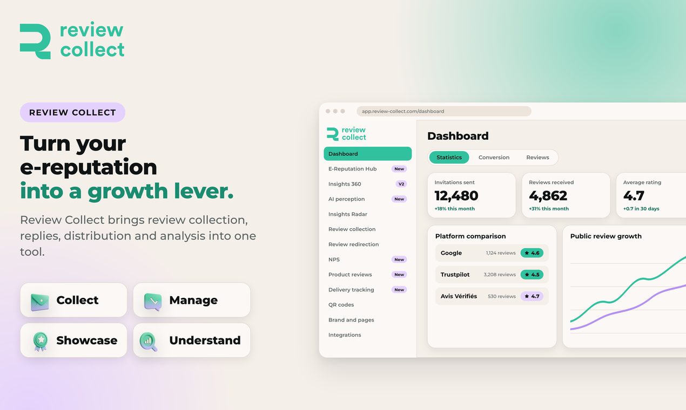

# Review Collect

Review Collect helps e-commerce and multichannel brands turn their e-reputation into a growth lever.

It brings every reputation mechanism into one tool: **collect** reviews, **manage** them, **showcase** them where they matter, and **understand** what they say.

## What it does

| | |
|---|---|
| **Collect** | Review requests by email, SMS, native WhatsApp and QR code, synced with delivery tracking. Product reviews, merchant reviews and photos. A 39% collection rate versus 3% on average on the market, and up to 30 times more reviews in 30 days. |
| **Manage** | AI replies in the brand's tone to every published review, positive or negative. Replies can be published automatically, or approved by the team first. Support tickets are created automatically. |
| **Showcase** | Reviews are distributed on Google, Trustpilot and marketplaces, and syndicated to product pages. |
| **Understand** | One dashboard, semantic analysis, NPS and CSAT, competitor monitoring, and tracking of what AI assistants say about the brand. |

Setup takes about 5 minutes. Review Collect connects to 40+ tools and is used by more than 500 brands.

## Documentation

| Guide | What you will find |
|---|---|
| [Getting started](docs/getting-started.md) | The first steps, from connecting your orders to your first review requests |
| [Collect reviews](docs/collect.md) | Channels, sequences, QR codes, sending limits and customer data |
| [Manage reviews](docs/manage.md) | AI replies, unsatisfied customers, support tickets |
| [Showcase reviews](docs/showcase.md) | Review routing, widgets and product pages |
| [Understand your reputation](docs/understand.md) | Dashboard, analysis, competitor monitoring |
| [Integrations](docs/integrations/README.md) | Shopify, PrestaShop, WhatsApp, and other ways to send customer data |
| [API reference](docs/api/README.md) | Programmatic access to your invitations and reviews |
| [Support](docs/support.md) | Help center, contact and account questions |

## Who it's for

E-commerce brands selling consumer goods in France, the UK, Ireland and the US.

## Links

- Website: https://www.review-collect.com/en
- Book a demo (free, pricing is shared during the demo): https://www.review-collect.com/en/demo
- Help center: https://help.review-collect.com/en/
- Developers: https://developers.review-collect.com/

## Available in

French, English and Spanish.
