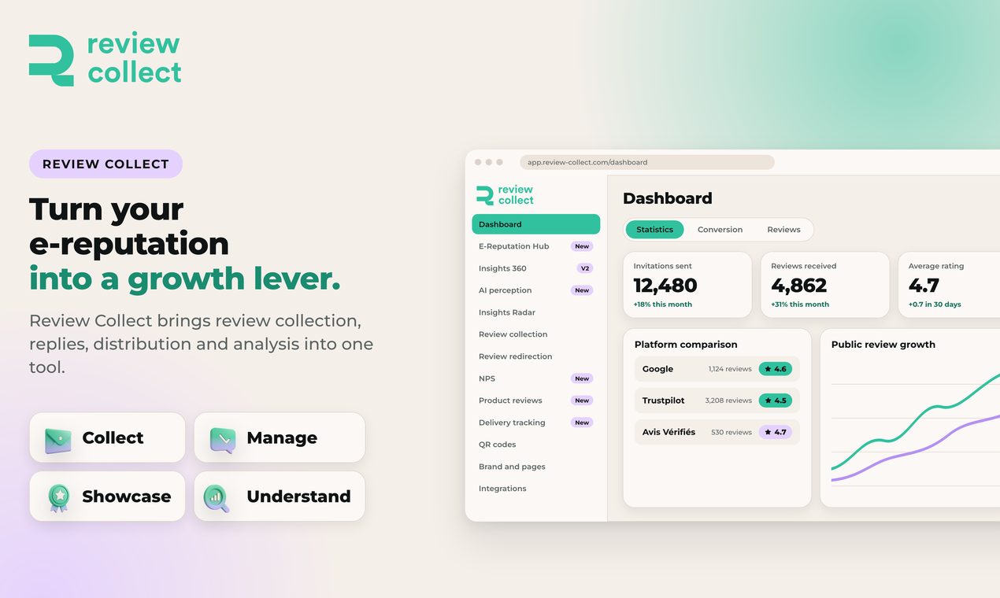

# Review Collect documentation

Review Collect helps e-commerce and multichannel brands turn their e-reputation into a growth lever.

This documentation follows the four things Review Collect does:

1. **Collect** your reviews by email, SMS, native WhatsApp and QR code. See [Collect reviews](collect.md).
2. **Manage** them with AI replies and automatic support tickets. See [Manage reviews](manage.md).
3. **Showcase** them on Google, Trustpilot, marketplaces and your product pages. See [Showcase reviews](showcase.md).
4. **Understand** what they say with one dashboard. See [Understand your reputation](understand.md).

New here? Start with [Getting started](getting-started.md).

Developers can go straight to the [API reference](api/README.md).
