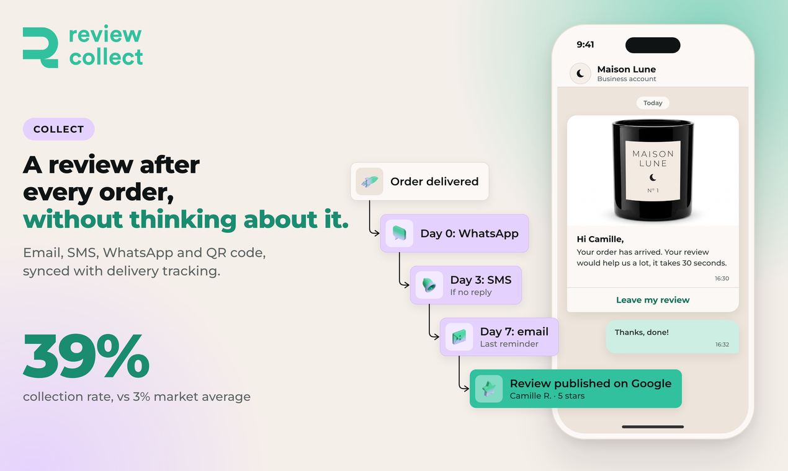

# Collect reviews

Review Collect sends review requests by email, SMS, native WhatsApp and QR code, synced with delivery tracking. You collect product reviews, merchant reviews and photos.

## How a request is sent

Review requests are triggered by your orders. They follow your delivery tracking, so each customer is asked at the right moment, after the order has arrived.

For SMS and WhatsApp, Review Collect sends the messages from its own Meta Business account, in white label. Customers see the message as coming from your brand, with a configurable sender name. Review Collect does not use the Klaviyo or Brevo account of the merchant: it is the sender.

## Channels and sequences

| Channel | Notes |
|---|---|
| Email | Review requests and reminders by email. |
| SMS | Sent with a configurable sender name. |
| WhatsApp | Native WhatsApp, through your connected WhatsApp Business account. See [WhatsApp](integrations/whatsapp.md). |
| QR code | A scannable code, for example on a package, a flyer or in a store. Each scan creates an invitation. |

The sequence is configurable: for example SMS first with WhatsApp as the fallback, or WhatsApp first with email as the fallback. Reminders can follow the initial message.

## Sending limits

On the **Review Collection > Advanced** page, the **Sending limits** card lets you control your volumes:

- **Limit WhatsApp invites per month.** Once the cap is reached, invites automatically fall back to your fallback channel (email or SMS) for the rest of the month. Nothing is blocked.
- **Limit invites per day, all channels.** The overflow goes out the next day, which is useful for a gradual rollout.

With limits disabled, there is no cap.

## Customer data

If you do not use a native integration, send your daily list of customers to invite through Google Sheets, FTP/SFTP or a custom integration. See [Other customer data options](integrations/other-data-sources.md) for the expected data structure.

## What you can collect

- Product reviews
- Merchant reviews
- Photo reviews

Product reviews can be moderated and displayed on your store. See [Showcase reviews](showcase.md).

## Results

Review Collect reports a 39% collection rate, compared with 3% on average on the market, and up to 30 times more reviews in 30 days.

## Next

- [Manage reviews](manage.md)
- [Showcase reviews](showcase.md)
