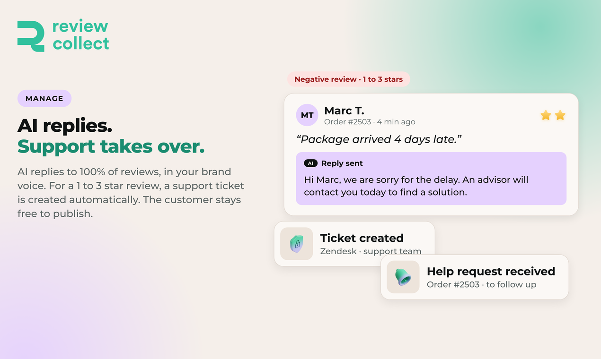

# Manage reviews

Review Collect helps you answer reviews and follow up with customers who need help.

## AI replies

Every published review, positive or negative, can receive a personalized reply written by AI in your brand's tone. This includes thank-you replies to positive reviews.

Replies can be published automatically, or approved by your team first. You choose the mode that fits your process.

For Trustpilot, replies can also be generated and published with the Review Collect Chrome extension.

## Unsatisfied customers

A customer who leaves 1, 2 or 3 stars follows this flow:

1. The customer lands on a **feedback page** in your brand's colors. Review Collect is not visible.
2. Review Collect **emails an alert to your support team**. It contains the feedback text, the order number, and the customer's phone number and email.
3. Your team contacts the customer. Review Collect can also **create a ticket in your ticketing tool**, such as Zendesk or Gorgias.
4. The customer always keeps the choice to publish a review. Review Collect blocks nothing.

## Support tickets

Support tickets are created automatically from customer feedback in the tools you connect, for example Zendesk and Gorgias. The Review Routing page also lets you choose to be notified by email, SMS, Slack, Zendesk, Gorgias or Crisp.

## Moderate product reviews

For product reviews left on your products, you read the reviews waiting for you, publish or hide them, and set your automatic publishing rules.

## Next

- [Showcase reviews](showcase.md)
- [Understand your reputation](understand.md)
