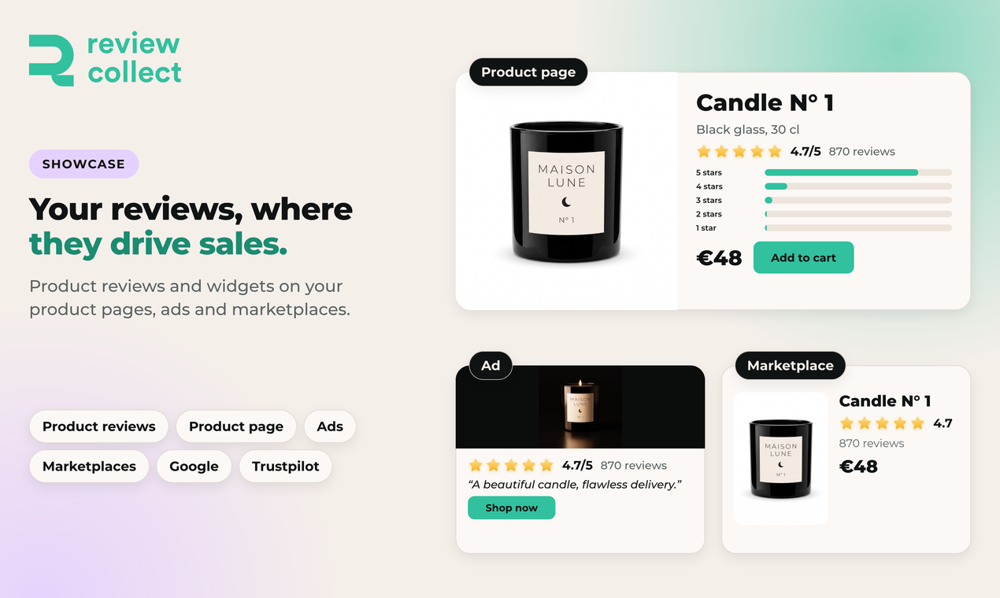

# Showcase reviews

Review Collect distributes your reviews on Google, Trustpilot and marketplaces, and syndicates them to your product pages, where you need them most.

Review Collect is not a review platform. It feeds the platforms that already exist, such as Google and Trustpilot, and complements them.

## Review routing

On the **Review Routing** page, you choose where satisfied customers (4 and 5 stars) are directed. Available destinations include Google, Trustpilot, Judge.me, the App Store, Google Play and a custom URL.

You configure the distribution yourself, for example by percentage or by balance of ratings. A customer is always sent to one platform at a time, never to several at once.

To add your Google link, see [Getting started](getting-started.md).

## Product review widgets

Show your product reviews on your store with the widgets:

- **Product reviews:** the list of reviews on your product pages.
- **Product star badge:** the star rating shown under the product title.
- **All reviews page:** a page listing all your product reviews.

You customize the layout, order, filters and content of each one.

On **Shopify**, Review Collect adds native blocks to your theme: no code to paste and no key to configure. Each block finds your Review Collect account from your store automatically. Your Shopify store must be connected first. See [Shopify](integrations/shopify.md).

On **PrestaShop**, you add the star badge, the reviews list and the all reviews page by pasting the code into your theme.

## Next

- [Understand your reputation](understand.md)
