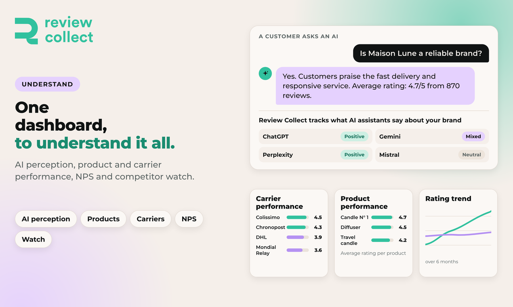

# Understand your reputation

Review Collect centralizes all your platforms in one dashboard, so you can see what customers say and act on it.

## What you get

- **One dashboard** for the reviews of all your platforms.
- **Semantic analysis** of your reviews.
- **NPS and CSAT** to follow customer satisfaction.
- **Competitor monitoring** with Insights Radar.
- **AI visibility tracking:** what AI assistants say about your brand.

## Insights Radar

Insights Radar lets you track your competitors. To follow a competitor's reviews, you need the exact Google Maps URL of their business. The help center explains how to find it.

## Export your data

You can load the history of your review invitations into your data warehouse, such as BigQuery or Snowflake, and keep it up to date every day with the [API](api/README.md).

## Next

- [API reference](api/README.md)
- [Support](support.md)
